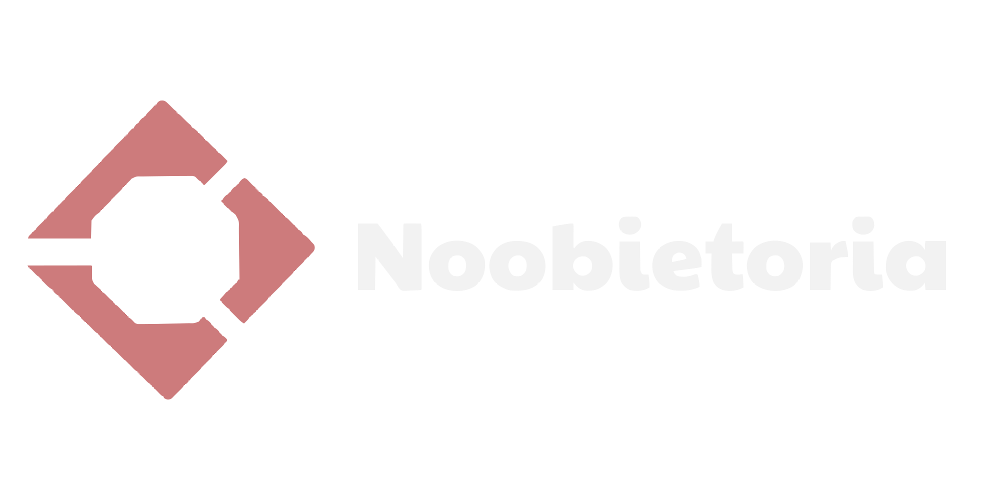

<div align="center">

<picture>
    <source media="(prefers-color-scheme: light)" srcset=".github/assets/logofullwhite.svg">
    
</picture>

# Noobietoria Monorepo

*A modular Rust-based game platform and world simulation ecosystem.*

[](https://github.com/noobietoria/noobietoria/issues)
[](https://github.com/noobietoria/noobietoria/pulls)
[](https://github.com/noobietoria/noobietoria/graphs/contributors)
[](https://github.com/noobietoria/noobietoria)
[](https://github.com/noobietoria/noobietoria/commits)
[](https://github.com/noobietoria/noobietoria/commits)

</div>

---

## 📖 Overview

**Noobietoria** is a modular Rust-based game platform and world simulation project. It is organized as a Cargo workspace and separates concerns across core types, world simulation, networking, rendering, scripting, API layers, and storage. 

The project is designed to support multiplayer experiences, gameplay scripting, and extensible world logic while maintaining a clean, layered architecture encompassing a game client, dedicated authoritative server, web frontend, and studio toolchain.

## 🏗 Project Structure & Architecture

```text
noobietoria/
├── .github/          # GitHub workflows, CI/CD, and asset files
├── _sigs/            # Game system specifications (economy, player, system, ui)
├── apps/             # End-user applications and services
│   ├── noobietoria-client     # PC app: icon rail, place grid, join a server
│   ├── noobietoria-dedicated  # Authoritative host server for multiplayer sessions
│   ├── noobietoria-studio     # Creator tooling & level editing suite
│   └── noobietoria-web        # Website + API (place catalog, server directory)
├── crates/           # Reusable engine crates and shared libraries
│   ├── nb-types      # Core shared data structures and types
│   ├── nb-world      # World simulation, map data, and logic
│   ├── nb-store      # Data persistence layer
│   ├── nb-api        # API layer specification
│   ├── nb-script     # Scripting engine and runtime (Lua/Luau integration)
│   ├── nb-net        # Networking, communication protocols, and streams
│   ├── nb-render     # Graphics rendering engine (wgpu-based)
│   └── nb-http       # HTTP service and web API routing (axum)
└── spec/             # API signatures, JSON schemas, and documentation tools
```

## ⚙️ Tech Stack & Dependencies

* **Language:** Rust (Edition 2021, target `1.85+`)
* **Architecture:** Cargo Workspace (Monorepo)
* **Async Runtime:** `tokio`
* **Rendering:** `wgpu`
* **UI Framework:** `egui` / `eframe` (Desktop & Studio UI)
* **Networking & Web:** `axum`, `tower-http`
* **Scripting:** `mlua` (Lua/Luau runtime)
* **Utilities & Security:** `serde`, `serde_json`, `uuid`, `argon2`, `reqwest`, `tracing`

## 🚀 Getting Started

### Prerequisites

Ensure you have **Rust 1.85+** and Cargo installed on your system (managed via `rust-toolchain.toml`).

1. **Clone the repository:**
   ```bash
   git clone https://github.com/noobietoria/noobietoria.git
   cd noobietoria
   ```

2. **Build the workspace:**
   ```bash
   cargo build --workspace
   ```

### Running Applications

* **Run the PC app:**
  ```bash
   cargo run -p noobietoria-client
   ```
  It opens on the Home shell — an icon rail (Home, Search, Explore, Avatar Shop,
  Create, Chat, Profile), the `Noobietoria` lockup and a grid of place tiles.
  Picking a place lists the servers running it and joins the one you choose; the
  player never types an IP address or a port. Home is the finished section today,
  the other six rail sections render a placeholder.

  Flags: `--api <URL>` points the app at a website other than
  `http://127.0.0.1:3000`, `--join <place_id>:<n>` jumps straight into an
  advertised server, `--username <NAME>` pre-fills the player name, and
  `--selftest` runs the headless ping check against `--server <HOST:PORT>`.

  The UI lives in the `noobietoria_client` library, so it can also be rendered to
  a PNG for design review:
  ```bash
   cargo run -p noobietoria-client --bin ui-shot -- shot.png [home|place|connecting|lobby] [w] [h]
  ```

* **Run the Dedicated Game Server:**
  ```bash
   cargo run -p noobietoria-dedicated
   ```

* **Run the Website (API + static pages):**
  ```bash
   cargo run -p noobietoria-web
   ```
  Listens on port 3000 (override with `-p <PORT>`). The hostname it advertises to
  clients defaults to `127.0.0.1`; set `NOOBIE_SERVER_HOST` when the dedicated
  servers run elsewhere. `--selftest` runs the backend, moderation and
  server-directory checks.

* **Run the Studio Tooling:**
  ```bash
   cargo run -p noobietoria-studio
   ```

### Brand artwork

The client ships the brand assets under `apps/noobietoria-client/assets/`:
`logo-mark.png`, `logo-wordmark.png` and the light `logo-lockup.png`. They are
derived from the design owner's artwork and can be regenerated with:

```bash
python scripts/make-logo-assets.py <mark.png> <light-lockup.png>
```

### Server directory API

The website is the single source of truth for join endpoints, so the client
never asks the player to type one:

```text
GET /api/v1/servers                       every joinable server
GET /api/v1/places/{place_id}/servers     joinable servers of one place
```

```json
{
  "count": 1,
  "servers": [
    {
      "server_id": "starter_baseplate:1",
      "place_id": "starter_baseplate",
      "place_name": "Classic Baseplate",
      "host": "127.0.0.1",
      "port": 53640,
      "players": 0,
      "max_players": 50,
      "region": "Singapore",
      "ping_ms": 60,
      "status": "online"
    }
  ]
}
```

The worlds page uses the same endpoint: clicking a world opens a dialog with its
live servers and a Join button per server.

### End-to-end check

With `noobietoria-web` running and a `noobietoria-dedicated` listening on an
advertised port, this discovers a server through the API and joins it over the
game protocol:

```bash
node scripts/e2e-join.mjs
```

## 🤝 Contributing

Contributions, issues, and feature requests are welcome! Feel free to check out the issues or submit a Pull Request.

## 📄 License

This project is open-source. Check the repository files for licensing information.